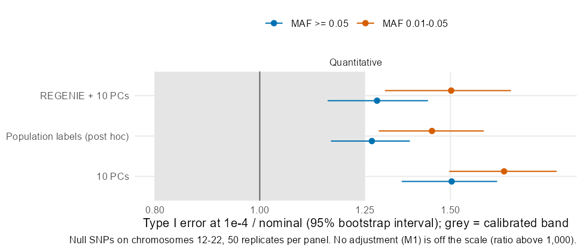
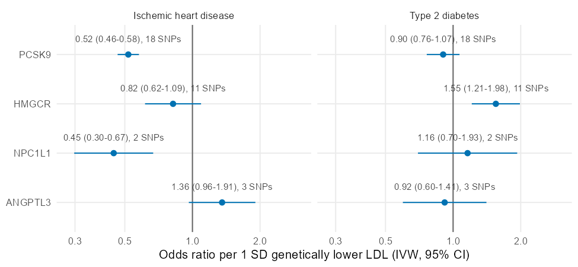

# GWAS calibration under population structure, and genetic support for lipid drug targets

This project asks two questions a human-genetics team meets every day. First, when a study sample mixes many ancestries, which association test keeps its false-positive rate where it should be: plain regression, regression on principal components, or a whole-genome regression mixed model (REGENIE)? Second, can public UK Biobank summary statistics recover what we already know about LDL-lowering drug targets, including the diabetes risk that comes with statins?

The first part uses the real genotypes of the 2,504 people in 1000 Genomes phase 3 (26 populations) with simulated traits, so the truth is known: 50 quantitative traits and 150 binary traits built from 500 polygenic SNPs, 10 large-effect SNPs and an environment that differs by population, all on chromosomes 1-11. Every association found on chromosomes 12-22 is a false positive. The methods are PLINK 2 linear and logistic regression without and with 10 PCs (with and without Firth fallback for binary traits), and REGENIE with Firth and saddlepoint corrections. The second part reads the Pan-UKB summary statistics for LDL cholesterol, ischemic heart disease and type 2 diabetes in the windows around PCSK9, HMGCR, NPC1L1 and ANGPTL3, and runs drug-target Mendelian randomization and colocalization.

The predictions and checks were written in `docs/design.md` before any genotype was downloaded; the results, with each prediction marked met or not met, are in `docs/readout.md`.

## Main results

- Without adjustment, structure across 26 populations inflates the genomic inflation factor to 8.2. Ten PCs leave 50% more false positives than nominal at p < 1e-4 for common variants and 68% more for low-frequency ones; REGENIE brings that to 28% and 50%. Neither is calibrated at this sample size, and REGENIE did not gain power over PCs (mean chi-square at the causal SNPs 0.90 times as large).
- Using the population labels instead of PCs (post hoc) leaves the same excess as REGENIE, so the residual inflation is not only the population-level environment.
- PCSK9: per 1 SD genetically lower LDL, the odds ratio for ischemic heart disease is 0.52 (95% CI 0.46-0.58) with 18 instruments, and LDL and heart disease share one causal variant (colocalization PP.H4 1.00).
- HMGCR: 0.82 (0.62-1.09) for heart disease and 1.55 (1.21-1.98) for type 2 diabetes, the known on-target effect of statins. NPC1L1: 0.45 (0.30-0.67). ANGPTL3 common variants give no support (1.36, 0.96-1.91; PP.H4 0.02).
- The 150 binary traits run on the University of Minnesota cluster (MSI) and are added when that run is back.

## Layout

- `docs/design.md`: questions, data, methods, predictions P1-P9, checks K1-K5, amendments.
- `docs/readout.md`: checks, results and verdicts.
- `scripts/a1_prepare.sh`: genotype QC, pruning, PCs, kinship, causal pool and test set (PLINK 2, run in WSL Ubuntu).
- `scripts/a2_simulate.py`: trait simulation and the variance check.
- `scripts/a3_run_methods.sh`: all association runs; each batch of results is condensed by `scripts/a4_summarize.py` and deleted, so the 15 million test results per method never pile up on disk.
- `scripts/a5_checks.py`, `scripts/a6_results.py`: checks K2-K3, tables and verdicts. `scripts/a7_posthoc_population.sh`: the post hoc population-label analysis.
- `py/tabix_range.py`: reads one genomic window from a remote bgzipped, tabix-indexed file with HTTP range requests, so a 2 GB summary-statistics file costs a few MB per gene. `scripts/b0_check_reader.py` tests it.
- `scripts/b1_fetch_panukb.py`, `scripts/b2_ld_reference.sh`, `scripts/b3_mr_coloc.R`: Part B.
- `scripts/c1_figures.R`: figures.
- `msi/`: the cluster run for the binary traits (Slurm array with prep, smoke and merge steps; see `msi/README.md`).
- `results/`, `figures/`: outputs.

## Reproducing

Genotypes: 1000 Genomes phase 3 in PLINK 2 format from the PLINK 2 resources page (about 3 GB), placed in `~/o_data` in WSL. Software: PLINK 2 alpha 7, REGENIE 4.1.3 (MKL build), Python 3.12 with NumPy, pandas and SciPy, R 4.4 with data.table, MendelianRandomization 0.10.0, coloc 5.2.3 and ggplot2. Run the scripts in name order; the `a` scripts need about 15 minutes on a 20-thread laptop for the quantitative traits, and the binary traits need the cluster or about four hours. Part B downloads only the gene windows and the tabix indexes from the Pan-UKB bucket on AWS.

Data sources: 1000 Genomes Project Consortium (phase 3); Pan-UK Biobank (pan.ukbb.broadinstitute.org), which is based on UK Biobank resources. Gene coordinates from Ensembl GRCh37.

Can Zhang, zhan8639@umn.edu. MIT license.
